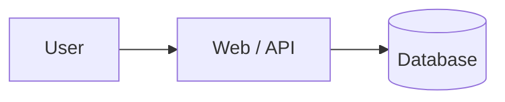

# Architecture design

Status: Draft | PRD: link | Owner: TBD | Updated: YYYY-MM-DD

## Requirements / quality attributes
Trace major decisions to PRD IDs.

## Options considered
| Option | Strengths | Costs/risks | Decision |
| --- | --- | --- | --- |
| Simplest viable | | | |
| Alternative | | | |

## System diagram

## Components and interfaces
Services, APIs, event flows, error contracts and owner.

## Data model
Entities, access control, migrations, backup, retention and deletion.

## Security and operations
Trust boundaries, auth, secrets, IAM, rate limits, logs and alerts.

## Environments / deployment
Local, staging, production, IaC approach, CI/CD and release gate.

## Cost and scale
Expected traffic, budgets and failure behavior.

## Rollback and disaster recovery
Application rollback, schema compatibility, data restore.

## ADRs and unresolved decisions
Links to templates/decisions/ADR-template.md and owners.
